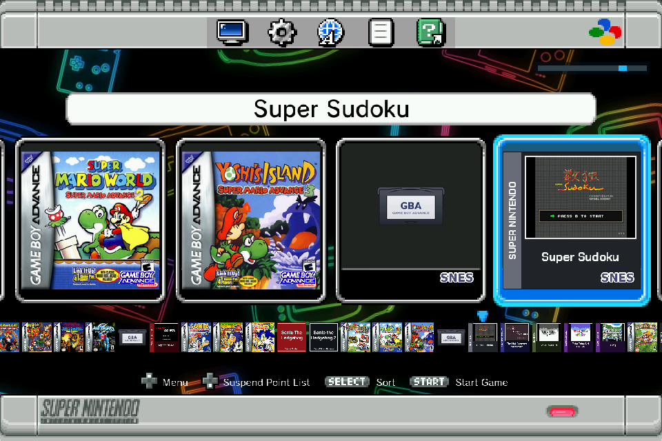
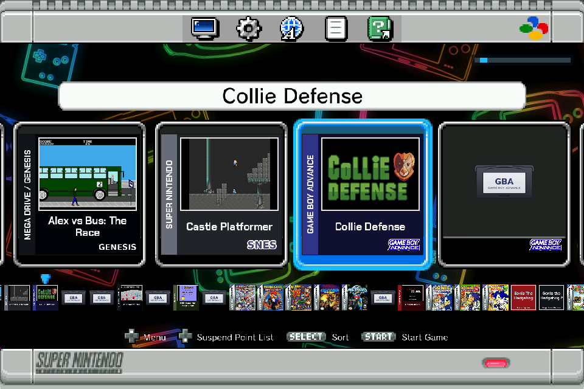
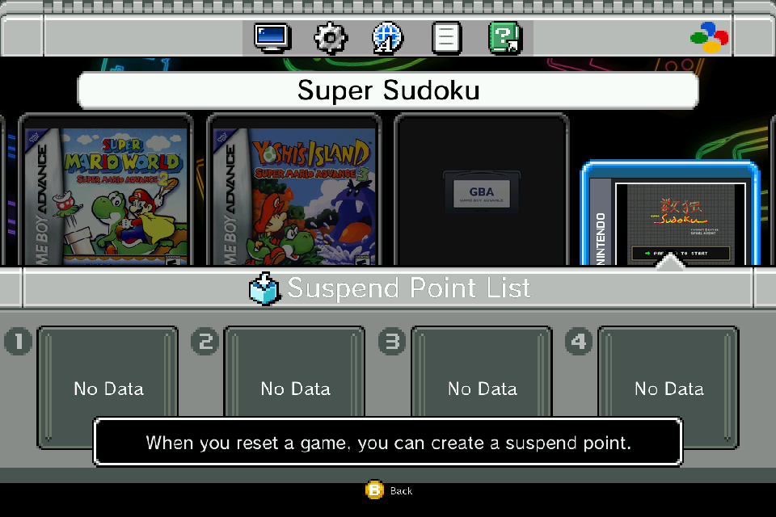
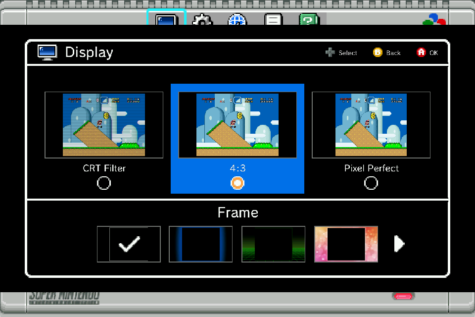
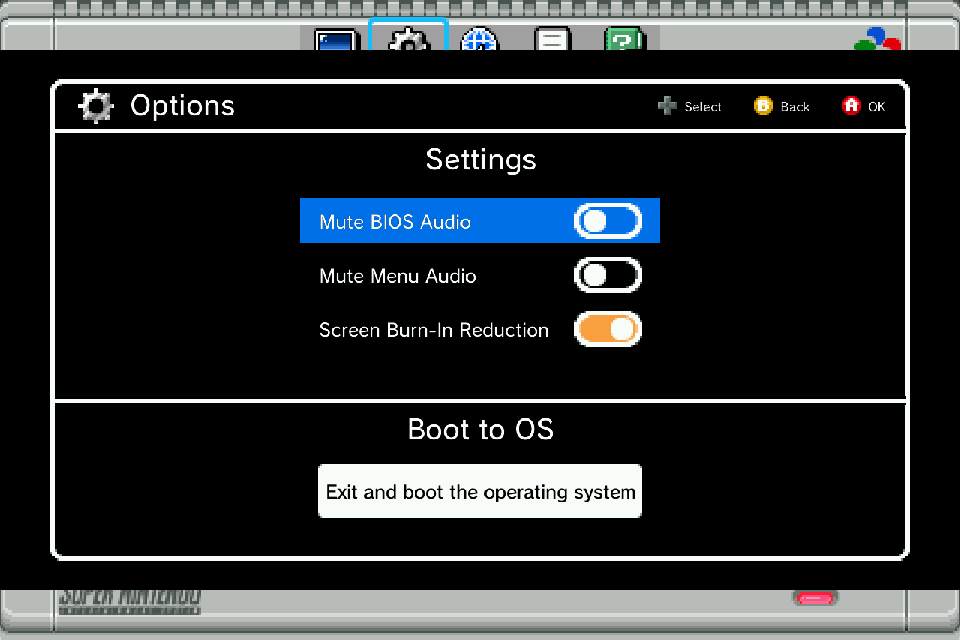
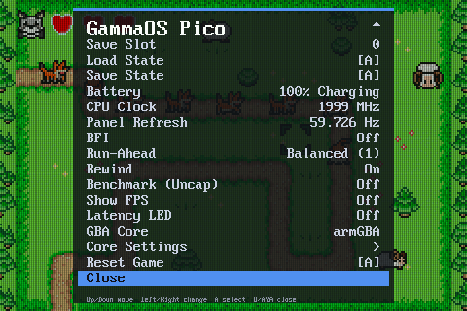
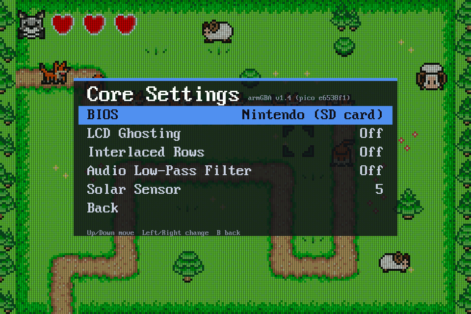

# GammaOS Pico

GammaOS Pico is a retro handheld OS that lives in the bootloader of MediaTek MT6785 handhelds.
It replaces only the LK bootloader and runs Game Boy, Game Boy Color, Game Boy Advance, SNES,
Mega Drive / Genesis, Master System, Game Gear and SG-1000 games straight from a microSD card.
Take the card out and the console boots its stock Android as before.



Supported consoles:

- **Konkr Pocket Advance**: the main target. Downloads are on the
  [releases page](https://github.com/TheGammaSqueeze/lk-mt6785/releases); details in
  [documentation/konkr-pocket-advance.md](documentation/konkr-pocket-advance.md).
- **AYANEO Pocket Air Mini**: the original port of this LK, see
  [documentation/pocket-air-mini](documentation/pocket-air-mini/README.md).

## What makes it different

GammaOS Pico isn't an app on top of Android or a Linux distro. It runs inside the console's
bootloader, before any operating system, and owns the hardware outright.

- **Fast on.** From power on to the GBA boot logo in about two and a half seconds (Android takes
  around 25). Hold Power to save where you are and switch off; turn it back on and you're back
  in the game.
- **Low latency by design.** The panel is retimed to each console's real refresh rate (59.73 Hz
  for GBA and Game Boy, 60.1 Hz for SNES, 50 Hz for PAL), every frame is paced to the panel's scan,
  buttons are read as late as possible, and run-ahead ("Preemptive Frames") hides the games' own lag.
- **Android stays.** Only the bootloader changes. Pull the card (or pick Boot to Android) and the
  console starts its stock Android, untouched.
- **Everything on the card.** Emulators, settings, saves, states and box art all live on the
  microSD card. Swap the card, swap the whole setup.
- **The good stuff from the start.** Rewind, fast forward, save states, suspend points, scanline
  and LCD filters, colour correction and backlight black frame insertion, in a box art menu.

## Screenshots

Captured on a Konkr Pocket Advance from the display buffers; the Pico menu shots lay its overlay over
the game the way the display hardware blends them.

| | |
|---|---|
|  |  |
| The game list, every system in one row, with the demo games from the release | Suspend points, made when you reset a game |
|  |  |
| Display: CRT filter, 4:3 or pixel perfect, and a frame around the game | Options: menu and BIOS sounds, burn-in reduction, Boot to Android |
|  |  |
| In game, with the LCD filter | The Pico menu over the game (Menu button) |
|  |  |
| Run-ahead, rewind, BFI, the live panel refresh and the core choice | Core Settings: each core's own options |

## Buttons

At power on:

| Hold | Starts |
|---|---|
| nothing | whatever the card is set to (GammaOS Pico, or Android after Boot to Android) |
| SELECT | GammaOS Pico (the way back after Boot to Android) |
| SELECT + START | Android |
| SELECT + START + R | the bootloader (fastboot), for updates |

No card, or a card without GammaOS Pico on it, always starts Android.

In a game:

| Button | Does |
|---|---|
| Menu | the Pico menu (save and load states, filters, settings); hold 1.5 s to go back to the game list |
| R2 | fast forward on / off |
| L2 | rewind on / off |
| SELECT + START + L + R (hold) | restart the game |
| Volume wheel | volume; with SELECT held, brightness |
| X / Y | autofire B / A |
| Power (hold 1.2 s) | save and switch off |

In the game list, START plays, SELECT sorts and X switches between systems. During the boot logo,
hold B to skip it; the volume wheel works there too.

## Install

Grab the latest [release](https://github.com/TheGammaSqueeze/lk-mt6785/releases). The flash
package writes the GammaOS Pico LK to `lk_a` and `lk_b` with SP Flash Tool (Windows) or mtkclient
(Linux), both of which work on a stock console with a locked bootloader, or with fastboot once
GammaOS Pico is installed. The SD card package goes on a FAT32 or exFAT card as it is: menu,
emulators and a set of freely licensed demo games with box art. Each package has a README.

## Build from source

```sh
git clone --recursive -b lk-gba-emu-sd-card-kpa https://github.com/TheGammaSqueeze/lk-mt6785.git
cd lk-mt6785
./build_konkr_kpa.sh                    # out/lk_a_kpa_signed.img + out/sdcard/ (the card)
tools/release/make_release_kpa.sh       # the two release zips in out/release/
```

You need Linux, Python 3 with Pillow and numpy, `openssl`, and `arm-none-eabi-gcc`/`g++` for the
cores (the LK itself builds with the toolchain in `gcc/`). The build fetches any core submodule
that is missing and rebuilds a core when its commit changes.

## Emulator cores

Each emulator is a separate program loaded from the card (`/cores/*.blob`), built in its own
repository with the emulator's upstream as a submodule, unmodified, plus GammaOS Pico patches and
glue. They are submodules here under `cores/`:

| Core | Systems |
|---|---|
| [armGBA-pico](https://github.com/TheGammaSqueeze/armGBA-pico) | Game Boy Advance (default, plays the boot intro) |
| [gpsp-pico](https://github.com/TheGammaSqueeze/gpsp-pico) | Game Boy Advance (needs a BIOS on the card) |
| [gambatte-pico](https://github.com/TheGammaSqueeze/gambatte-pico) | Game Boy, Game Boy Color |
| [snes9x-pico](https://github.com/TheGammaSqueeze/snes9x-pico) | SNES |
| [genesis-plus-gx-pico](https://github.com/TheGammaSqueeze/genesis-plus-gx-pico) | Mega Drive / Genesis, Master System, Game Gear, SG-1000 |

## Repository layout

| Path | What |
|---|---|
| `emu/` | GammaOS Pico itself: the SD boot gate, FAT/exFAT, the menu, input, display and audio, and the loader and session code for each core |
| `cores/` | the emulator cores (submodules) |
| `platform/mt6785/`, `dev/lcm/` | the MT6785 platform code, the GammaOS Pico drivers (`ayaneo_*`) and the panel drivers |
| `project/` | build configurations: `k85v1_64_kpa.mk` (Konkr), `k85v1_64.mk` (Pocket Air Mini) |
| `tools/release/` | the release build: packages, scatter files, demo games and box covers |
| `tools/ayaneo/`, `tools/konkr/` | signing, the menu packer, the card builder, the stock firmware files |
| `documentation/` | device docs, and `development/` for the engineering notes kept from the ports |
| `build_*.sh` | build entry points: `build_konkr_kpa.sh`, `build_ayaneo_gba_sd.sh`, `build_ayaneo_pocket_air_mini.sh` |

The rest (`app/`, `arch/`, `kernel/`, `lib/`, `include/`, `make/`, `target/`, `scripts/`, `certs/`,
`gcc/`) is the MediaTek LK it is built on.

## Licence

The Little Kernel code and the GammaOS Pico additions are MIT ([LICENSE](LICENSE)). The MediaTek
BSP files, the stock firmware files, the SNES Classic menu assets and the emulator cores keep their
own terms; [LICENSES.md](LICENSES.md) says which part is under what.

## Credit

Built on [svoboda18/lk](https://github.com/svoboda18/lk) (MediaTek LK). The emulators are their
authors' work: armGBA, gpSP, gambatte, snes9x and Genesis Plus GX. The story of how the first core
ended up in a bootloader is in [documentation/how-cursed-is-this.md](documentation/how-cursed-is-this.md).
