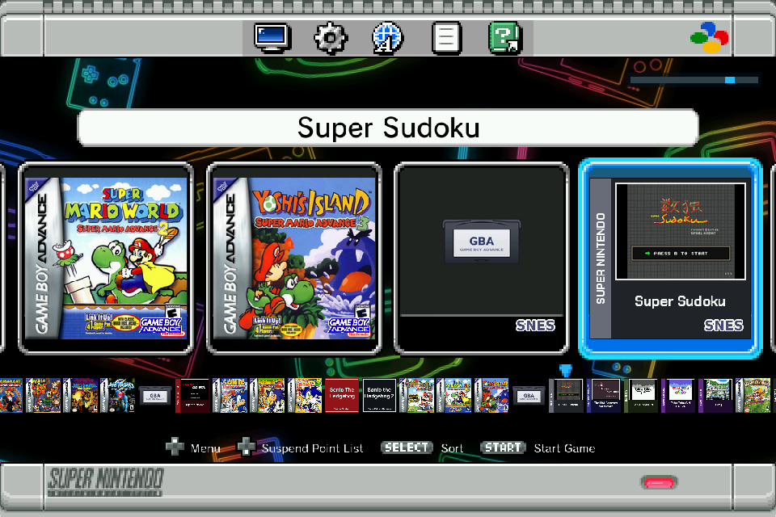
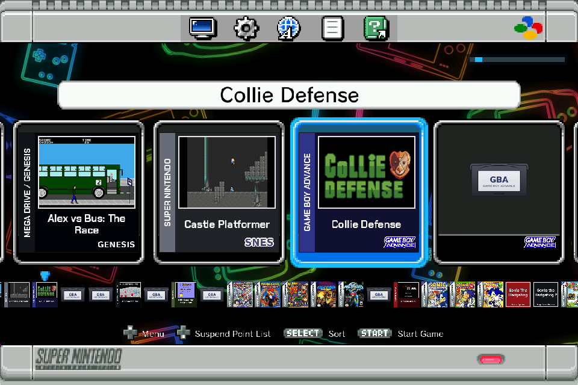
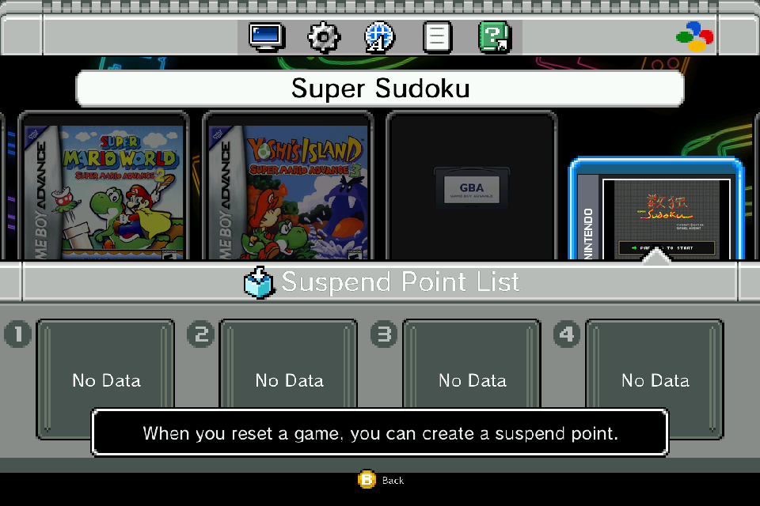
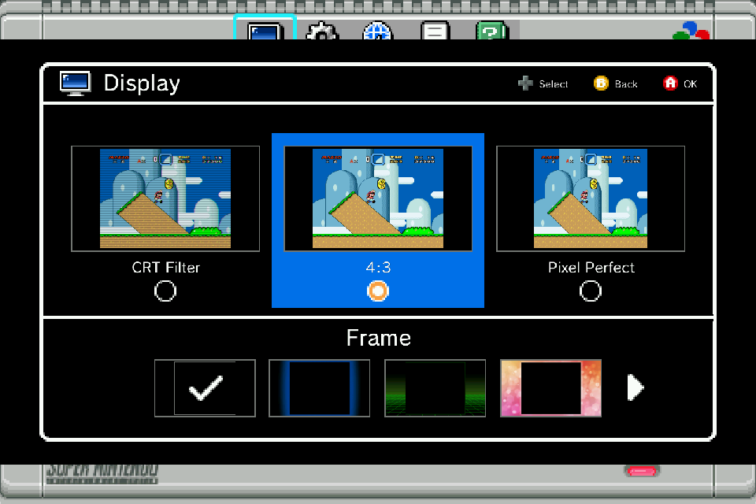
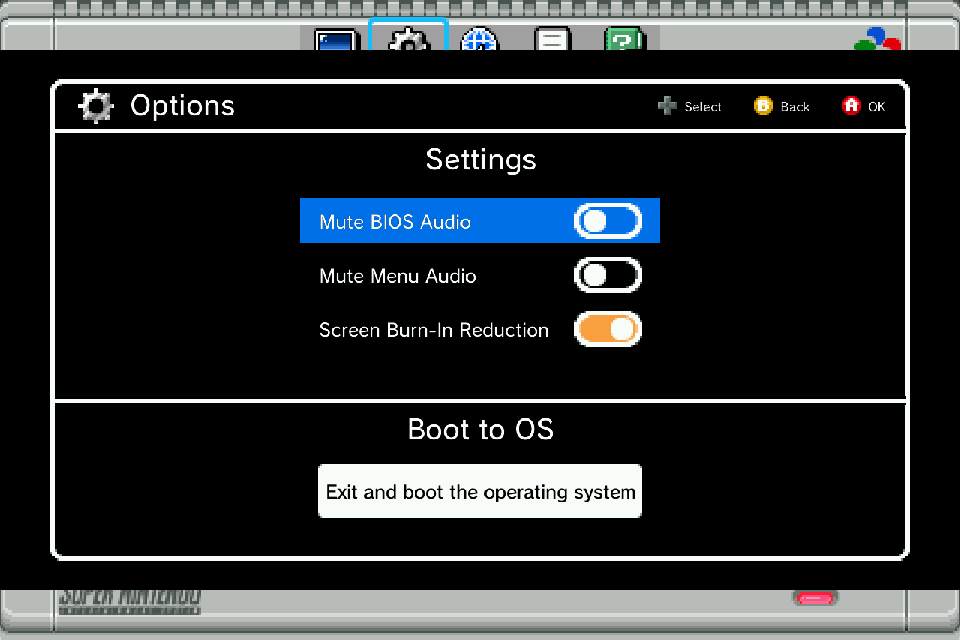
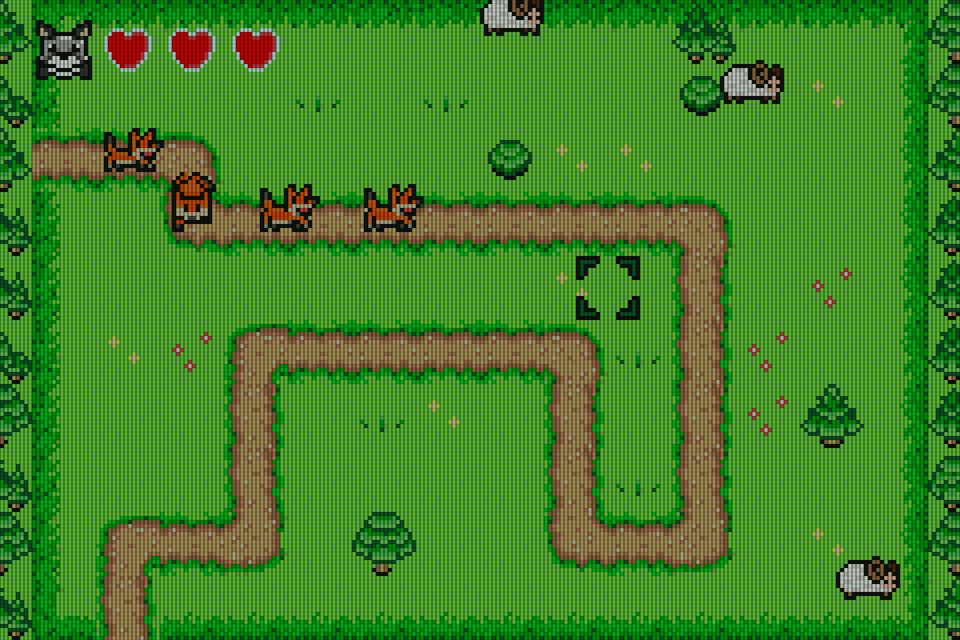
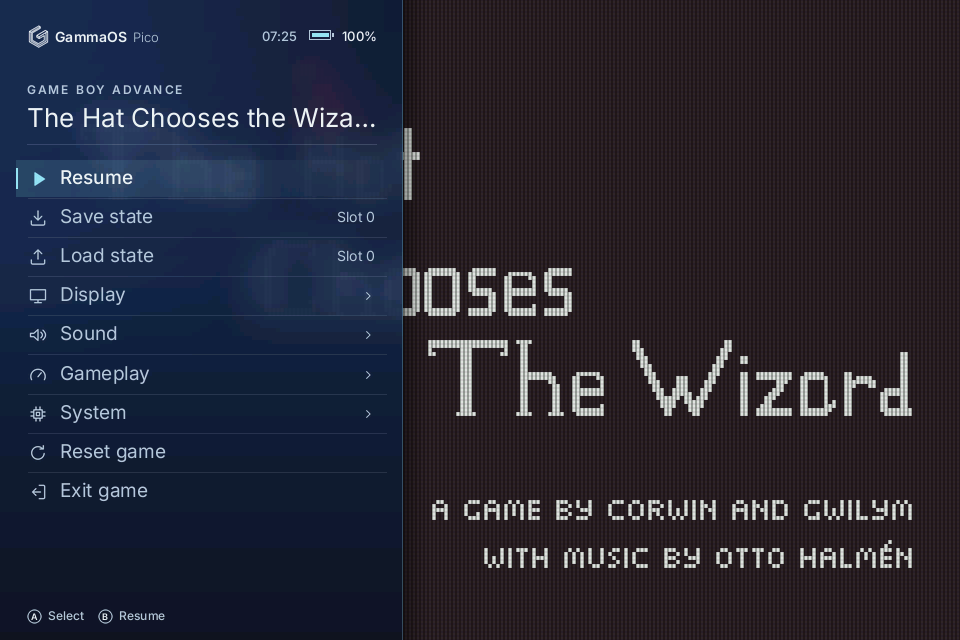
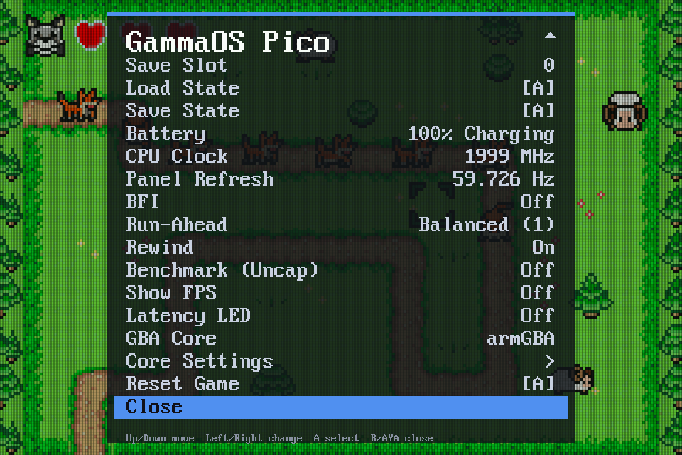
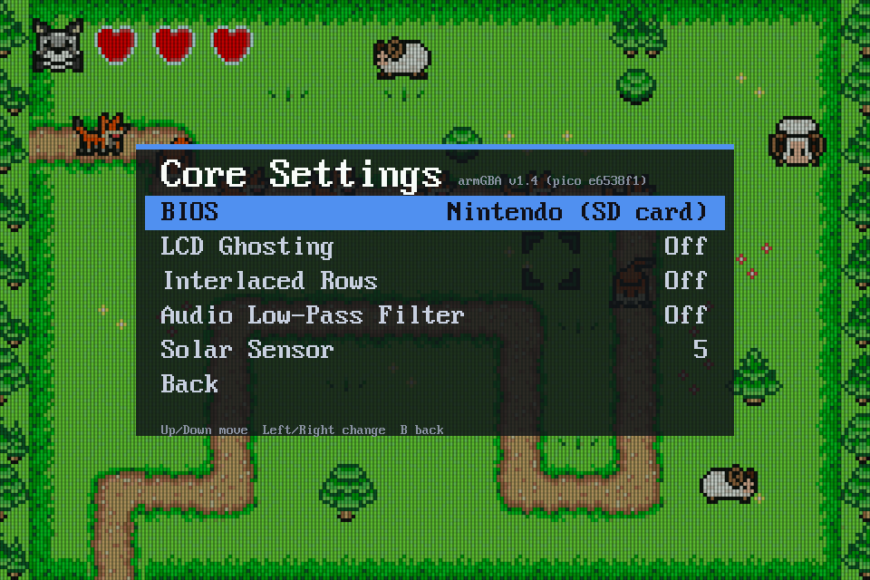

GammaOS Pico for the **Konkr Pocket Advance**, release @VERSION@ (lk-mt6785 `@COMMIT@`).

GammaOS Pico replaces only the console's bootloader (LK). With the GammaOS Pico microSD card in the slot the
console starts a console menu and plays Game Boy, Game Boy Color, Game Boy Advance, SNES,
Mega Drive / Genesis, Master System, Game Gear and SG-1000 games from the card. Without the card,
or after Boot to Android in the menu, Android starts exactly as before.

## What makes it different

GammaOS Pico isn't an app on top of Android or a Linux distro. It runs inside the console's
bootloader, before any operating system, and owns the hardware outright.

- **Fast on.** From power on to the GBA boot logo in about two and a half seconds (Android takes
  around 25). Hold Power to save where you are and switch off; turn it back on and you're back
  in the game.
- **Low latency by design.** The panel is retimed to each console's real refresh rate (59.73 Hz
  for GBA and Game Boy, 60.1 Hz for SNES, 50 Hz for PAL), every frame is paced to the panel's scan,
  buttons are read as late as possible, and run-ahead ("Preemptive Frames") hides the games' own lag.
- **Android stays.** Only the bootloader changes. Pull the card (or pick Boot to Android) and the
  console starts its stock Android, untouched.
- **Everything on the card.** Emulators, settings, saves, states and box art all live on the
  microSD card. Swap the card, swap the whole setup.
- **The good stuff from the start.** Rewind, fast forward, save states, suspend points, scanline
  and LCD filters, colour correction and backlight black frame insertion, in a box art menu.

## Screenshots

Captured on a Konkr Pocket Advance.

| | |
|---|---|
|  |  |
| The game list, every system in one row, with the demo games from this release | Suspend points, made when you reset a game |
|  |  |
| Display: CRT filter, 4:3 or pixel perfect, and a frame around the game | Options: menu and BIOS sounds, burn-in reduction, Boot to Android |
|  |  |
| In game, with the LCD filter | The Pico menu over the game (Menu button) |
|  |  |
| Run-ahead, rewind, BFI, the live panel refresh and the core choice | Core Settings: each core's own options |

## Buttons

At power on:

| Hold | Starts |
|---|---|
| nothing | whatever the card is set to (GammaOS Pico, or Android after Boot to Android) |
| SELECT | GammaOS Pico (the way back after Boot to Android) |
| SELECT + START | Android |
| SELECT + START + R | the bootloader (fastboot), for updates |

No card, or a card without GammaOS Pico on it, always starts Android.

In a game:

| Button | Does |
|---|---|
| Menu | the Pico menu (save and load states, filters, settings); hold 1.5 s to go back to the game list |
| R2 | fast forward on / off |
| L2 | rewind on / off |
| SELECT + START + L + R (hold) | restart the game |
| Volume wheel | volume; with SELECT held, brightness |
| X / Y | autofire B / A |
| Power (hold 1.2 s) | save and switch off |

In the game list, START plays, SELECT sorts and X switches between systems. During the boot logo,
hold B to skip it; the volume wheel works there too.

## Downloads

- **gammaos-pico-kpa-@VERSION@-flash.zip**: the LK for `lk_a` and `lk_b`, to install GammaOS Pico and to go
  back to stock: SP Flash Tool v5 and V6 scatters (Windows) and mtkclient scripts (Linux), both of
  which work on a stock console with a locked bootloader, plus fastboot scripts for updates. Read
  its README.txt.
- **gammaos-pico-kpa-@VERSION@-sdcard.zip**: the card. Copy its contents to the root of a FAT32 or
  exFAT microSD card. It has the menu, the five emulator cores and the demo games below.

## Install

1. Flash the GammaOS Pico LK from the flash package: on Windows `spflash/gammaos/` with SP Flash Tool
   (V6 `.xml` or v5 `.txt` scatter, mode Download Only, only `lk_a` and `lk_b` ticked); on Linux
   `mtkclient/flash_gammaos.sh` with [mtkclient](https://github.com/bkerler/mtkclient).
2. Copy the sdcard package's contents to a microSD card, put it in and power on.
3. Optional: put your own Game Boy Advance BIOS on the card as `bios/gba_bios.bin` for the original
   boot logo; without it armGBA's own Open BIOS splash plays.

To go back, flash `spflash/stock/` or run `mtkclient/flash_stock.sh` the same way.

### What has been tested on a console

| Method | Status |
|---|---|
| SP Flash Tool V6 with the `.xml` scatter | tested: the route the first consoles were installed with |
| fastboot scripts (updates) | tested: both slots written, the console starts GammaOS Pico |
| SP Flash Tool v5 with the `.txt` scatter | **untested** on a console (same partitions and files as V6) |
| mtkclient on Linux | **untested** on a console (writes the same two partitions) |

If you use one of the untested methods, please report how it went.

## Demo games

@GAMES@

Each is redistributed under its licence; the texts are in `licences/games/` on the card.

## Source

- LK: https://github.com/TheGammaSqueeze/lk-mt6785 (branch `lk-gba-emu-sd-card-kpa`); build this
  release with `tools/release/make_release_kpa.sh`.
- Cores: [armGBA-pico](https://github.com/TheGammaSqueeze/armGBA-pico),
  [gpsp-pico](https://github.com/TheGammaSqueeze/gpsp-pico),
  [gambatte-pico](https://github.com/TheGammaSqueeze/gambatte-pico),
  [snes9x-pico](https://github.com/TheGammaSqueeze/snes9x-pico),
  [genesis-plus-gx-pico](https://github.com/TheGammaSqueeze/genesis-plus-gx-pico).

Checksums are in `SHA256SUMS`.
